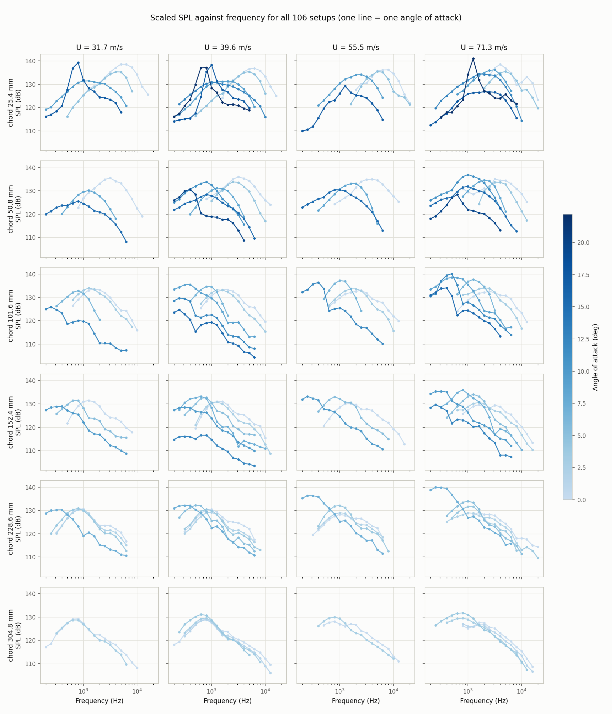

Data exploration
================

These figures show the full dataset (all 1503 rows, including the test
hold-out) before any model is fitted. They are written to ``doc/generated/``
by ``src/explore_plots.py``. To update this page:

.. code-block:: console

    python src/explore_plots.py --no-show
    sphinx-build -b html doc doc/_build/html

Distribution of the target
--------------------------

.. figure:: generated/explore_spl_distribution.png
   :width: 85%
   :alt: Histogram of scaled sound pressure level in 1 dB bins, with dashed
         and dotted lines at the mean and median.

   Number of observations in each 1 dB band of scaled sound pressure level,
   with the mean and median marked.

Measured spectra
----------------

         velocity, each showing SPL against frequency with one line per angle
         of attack, coloured from light (0 deg) to dark (22.2 deg).

   Measured SPL against frequency (log axis) for all 106 setups. Rows are
   chord lengths, columns are free-stream velocities, and each line is one
   angle of attack (colour bar).

Feature set A: the raw inputs
-----------------------------

.. figure:: generated/explore_spl_vs_features.png
   :width: 100%
   :alt: Five scatter plots of SPL against frequency, angle of attack, chord
         length, free-stream velocity and displacement thickness.

   SPL against each of the five raw inputs. Frequency is on a log axis.

Feature set B: the physics-derived features
-------------------------------------------

.. figure:: generated/explore_spl_vs_physics_features.png
   :width: 100%
   :alt: Three scatter plots of SPL against log frequency, Strouhal number
         and chord Reynolds number.

   SPL against the three features that set B adds to set A: log10
   frequency, Strouhal number and chord Reynolds number. Strouhal and
   Reynolds numbers are on log axes.

Tonal peaks
-----------

.. figure:: generated/explore_tonal_peaks.png
   :width: 85%
   :alt: Peak prominence against chord Reynolds number on a log axis, one
         dot per setup, coloured and shaped by angle-of-attack band.

   Each dot is one setup (one measured spectrum): the prominence of its
   largest peak (height above its surroundings) against the chord Reynolds
   number (log axis). Colour and marker show the angle band.
