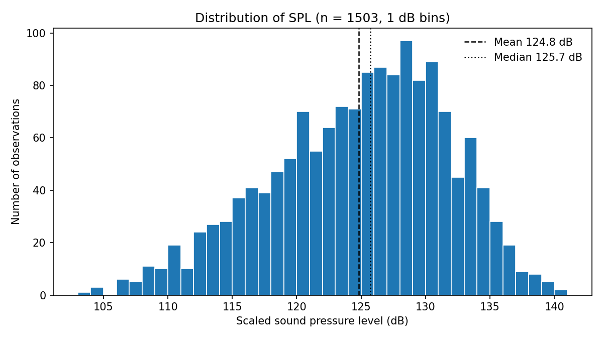
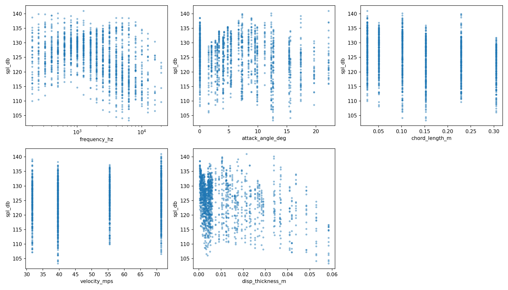
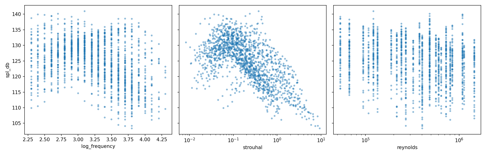
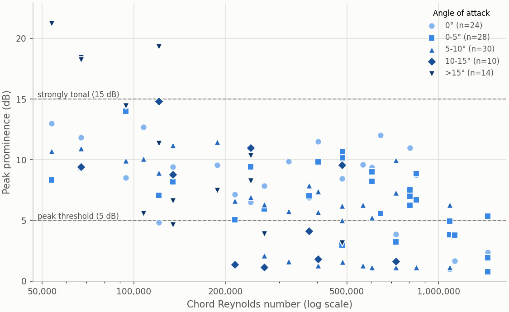

Data exploration
================

These figures show the full dataset (all 1503 rows, including the test
hold-out) before any model is fitted. They are written to ``doc/generated/``
by ``src/explore_plots.py``. To update this page:

.. code-block:: console

    python src/explore_plots.py --no-show
    sphinx-build -b html doc doc/_build/html

Distribution of the target
--------------------------

         and dotted lines at the mean and median.

   Number of observations in each 1 dB band of scaled sound pressure level.

SPL ranges from about 103 to 141 dB, with a mean of 124.8 dB and a standard
deviation of 6.9 dB. The distribution is skewed to the left (skewness about
−0.4): most measurements lie between 120 and 135 dB, with a longer tail of
quiet conditions. The mean is slightly below the median (125.7 dB) for the
same reason. Few rows lie in either tail, so models have little data to
learn from there. This helps explain why the linear baseline pulls its
predictions towards the mean (see :doc:`results`).

Feature set A: the raw inputs
-----------------------------

         length, free-stream velocity and displacement thickness.

   SPL against each of the five raw inputs. Frequency is on a log axis.

Chord length and velocity take only six and four distinct values, and the
angle of attack 27, so the data form vertical bands rather than a
continuous cloud. Within every band SPL spreads over 20 to 30 dB, so no
single input explains much of the variance on its own. The average SPL
rises slightly up to about 800 Hz and then falls at higher frequencies. This hump is a
non-linear shape that a straight line in frequency cannot follow.

Feature set B: the physics-derived features
-------------------------------------------

         and chord Reynolds number.

   SPL against the three features that set B adds to set A: log10
   frequency, Strouhal number and chord Reynolds number. Strouhal and
   Reynolds numbers are on log axes.

The Strouhal number, which combines frequency, displacement thickness and
velocity, collapses the data far more tightly than any raw input. Most of
the loudest points lie at Strouhal numbers of roughly 0.03 to 0.2, and SPL
falls steadily at higher values. This suggests
the spectra share a similar shape once frequency is scaled this way. The
relationship is still curved, so even with this feature a linear model
cannot fit it fully. Reynolds number, like chord and velocity, shows
vertical bands with a wide SPL spread in each.

Tonal peaks
-----------

         dot per setup, coloured and shaped by angle-of-attack band.

   Each dot is one setup (one measured spectrum): how far its biggest peak
   stands above its surroundings (peak prominence), against the chord
   Reynolds number (log scale). Colour and marker show the angle band.

Some spectra have a narrow tonal peak standing well above the broadband
level. All four strongly tonal setups (prominence of 15 dB or more) have the
smallest chord (0.0254 m), an angle of 17.4–22.2° and a Reynolds number of
at most about 121,000. In general, prominence falls as the Reynolds number
rises: the median is about 10 dB below Re ≈ 160,000, but about 6 dB above
Re ≈ 400,000.
