Results
=======

Tables and figures produced by the scripts in ``src/``; the numbers are read
from ``doc/generated/`` and ``results/``, not typed in. Unless stated
otherwise, results use the cross-validation data only (90 setups); the test
hold-out is used only in `Final hold-out evaluation`_. "±" is the standard
deviation over the 15 cross-validation folds (5 folds × 3 seeds). Feature set
A is the five raw inputs; feature set B adds log10 frequency, the Strouhal
number and the chord Reynolds number.

Verification: manufactured-solution tests
-----------------------------------------

.. csv-table:: Manufactured-solution checks: the linear pipeline on y = 3 + 2x1 − 5x2, the final MLP on y = sin(x) (200 points, scored between the training points), and linear on the same sine as a negative control. The MLP pass marks were set after a first measurement.
   :file: generated/verification.csv
   :header-rows: 1

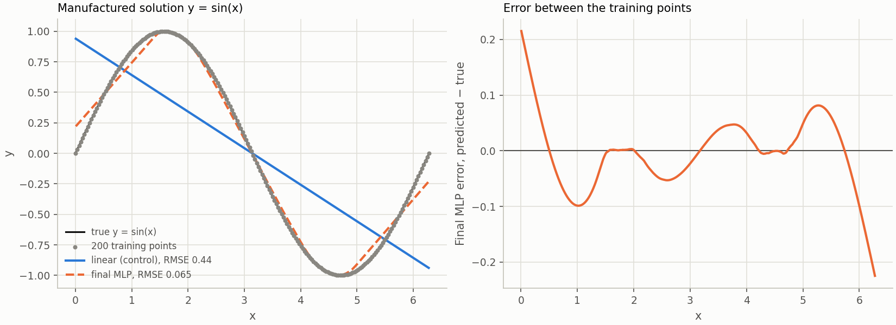
         the linear control. Right, the final MLP's error along x.

   Left: y = sin(x), its 200 training points, the final MLP's fit and the
   linear control. Right: the final MLP's error between the training points.

Linear baseline
---------------

.. csv-table:: Linear baseline: validation metrics for feature sets A and B (mean ± SD over 15 folds) and mean time per fold
   :file: generated/cv_summary.csv
   :header-rows: 1

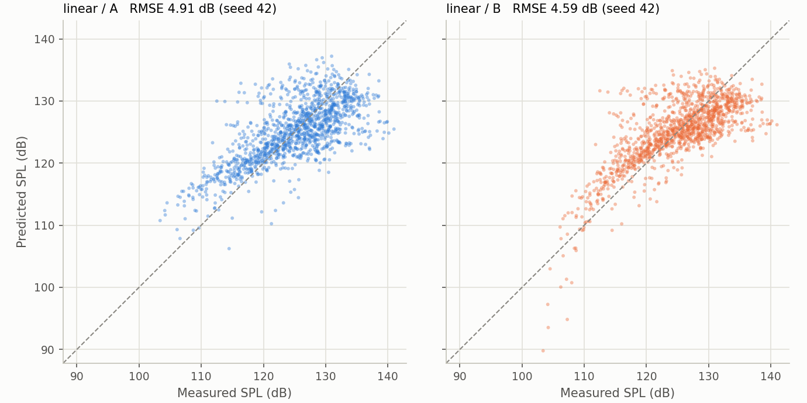
         feature set, with a dashed y = x line.

   Out-of-fold predicted against measured SPL for the linear model on
   feature sets A and B (one CV seed); the dashed line is y = x.

.. csv-table:: Out-of-fold RMSE (dB) of the linear model by chord, velocity, angle band and frequency band (mean over seeds; Rows = measurements per group)
   :file: generated/cv_rmse_breakdown.csv
   :header-rows: 1

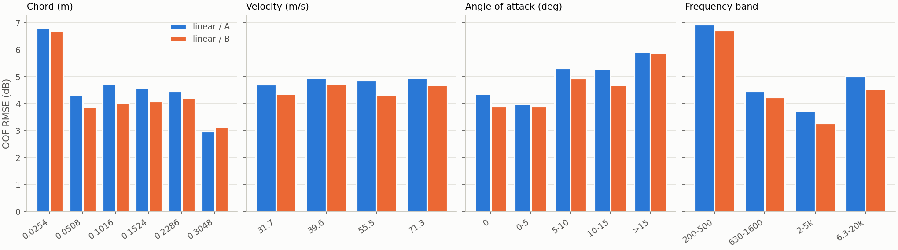
         band and frequency band, one bar per feature set.

   Out-of-fold RMSE of the linear model by chord, velocity, angle band and
   frequency band, for feature sets A and B.

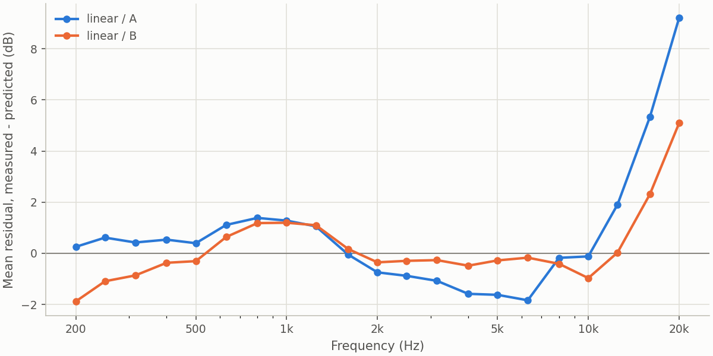
         axis, one line per feature set.

   Mean out-of-fold residual (measured − predicted) of the linear model at
   each measured frequency, for feature sets A and B (one CV seed).

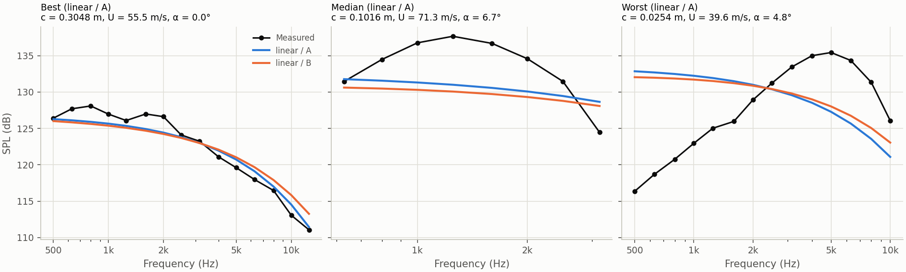
         worst predicted setups, comparing measured spectra with predictions.

   Measured and out-of-fold predicted spectra (linear, sets A and B) for the
   best, median and worst predicted setups, ranked by per-setup RMSE on set A.

.. csv-table:: Linear coefficients in dB per input standard deviation, mean ± SD over the 15 fits [percentage of fits agreeing in sign]
   :file: generated/cv_coefficients.csv
   :header-rows: 1

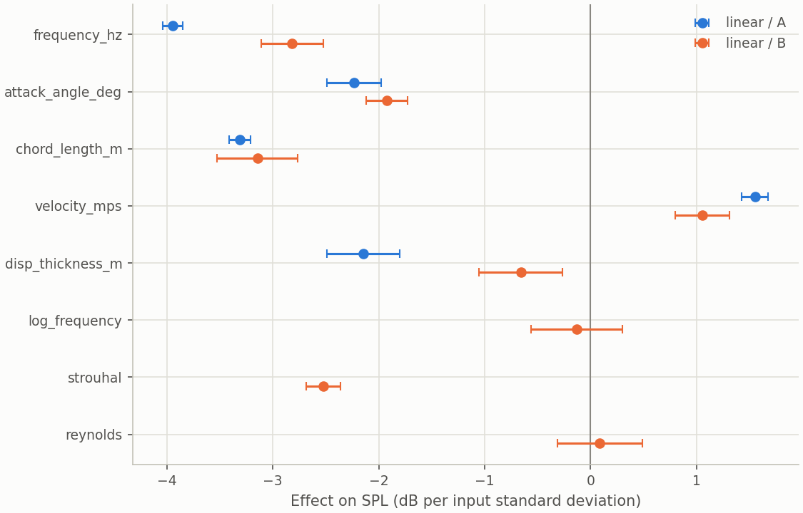
         across folds, for each feature set.

   Linear coefficients (dB per input standard deviation) with whiskers of
   ± one SD over the 15 fits, for feature sets A and B.

Tuned MLP (nested cross-validation)
-----------------------------------

The inner grouped 5-fold CV searched 35 settings (hidden layers (32,), (64,),
(32, 32), (64, 64), (128, 128); alpha 1e-5 to 10) on each outer fold's
training setups; the chosen setting was scored on the outer fold.

Accuracy and comparison with linear
~~~~~~~~~~~~~~~~~~~~~~~~~~~~~~~~~~~

.. csv-table:: Tuned MLP outer-fold results for feature sets A and B, with the paired per-fold difference from linear (MLP − linear)
   :file: generated/tuning_summary.csv
   :header-rows: 1

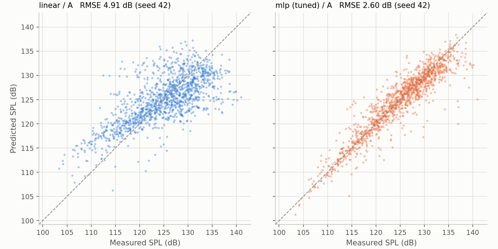
         MLP on feature set A.

   Out-of-fold predicted against measured SPL on feature set A: linear (left)
   and tuned MLP (right), one CV seed.

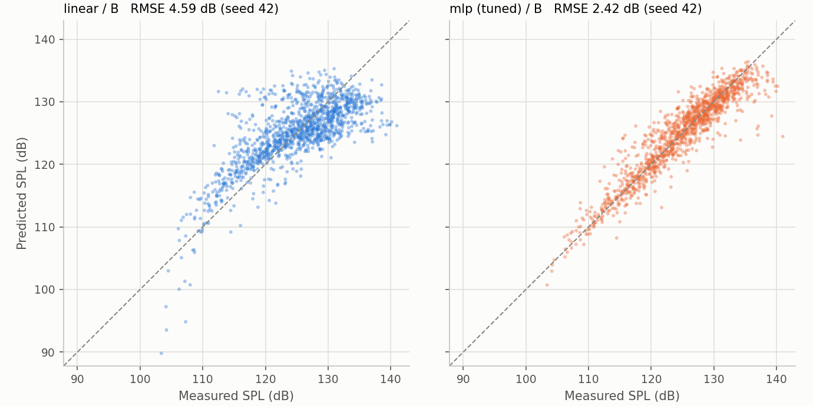
         MLP on feature set B.

   Out-of-fold predicted against measured SPL on feature set B: linear (left)
   and tuned MLP (right), one CV seed.

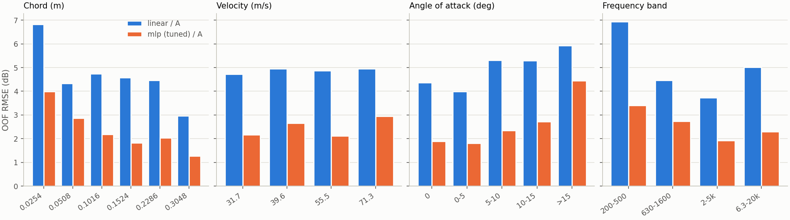
         frequency band for linear and tuned MLP, feature set A.

   Out-of-fold RMSE by chord, velocity, angle band and frequency band for
   linear and the tuned MLP, feature set A.

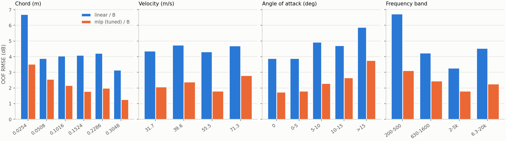
         frequency band for linear and tuned MLP, feature set B.

   Out-of-fold RMSE by chord, velocity, angle band and frequency band for
   linear and the tuned MLP, feature set B.

Settings chosen and training
~~~~~~~~~~~~~~~~~~~~~~~~~~~~

.. csv-table:: Settings chosen by the inner CV and the number of outer folds each won (settings that never won are omitted)
   :file: generated/tuning_selected_params.csv
   :header-rows: 1

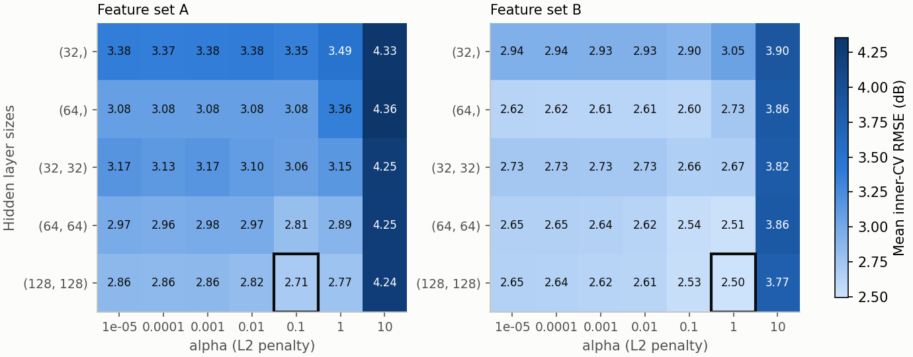
         feature sets A and B, with the best cell outlined.

   Mean inner-CV RMSE for each network size and alpha, averaged over all
   outer folds and seeds, for feature sets A and B; the outlined cell has
   the lowest value.

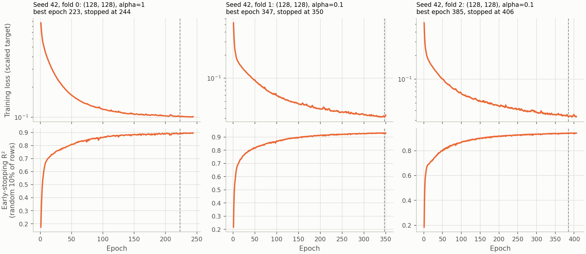
         MLP in three outer folds, feature set A.

   Training loss (top) and early-stopping R² (bottom) per epoch for the
   selected MLP in three outer folds, feature set A; the dashed line marks
   the best epoch.

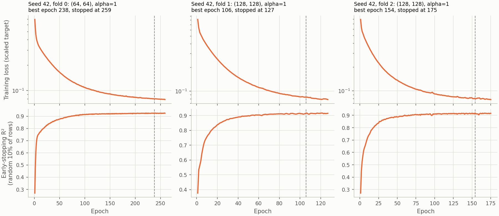
         MLP in three outer folds, feature set B.

   Training loss (top) and early-stopping R² (bottom) per epoch for the
   selected MLP in three outer folds, feature set B; the dashed line marks
   the best epoch.

Worst-predicted setups and error analysis
-----------------------------------------

.. csv-table:: The 10 setups with the highest out-of-fold tuned-MLP RMSE, feature set B (bias = mean of measured − predicted)
   :file: generated/worst_setups_B.csv
   :header-rows: 1

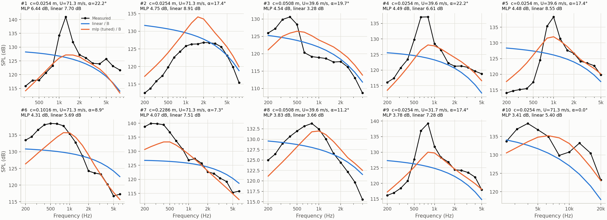
         comparing the measured spectrum with linear and tuned-MLP predictions.

   Measured spectra (black) and out-of-fold predictions of linear and the
   tuned MLP (averaged over seeds) for the 10 worst setups, feature set B.

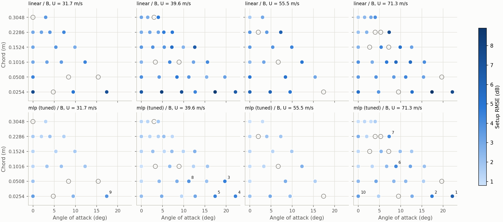
         attack and chord, coloured by its RMSE, for linear and tuned MLP.

   Out-of-fold RMSE of every cross-validation setup by velocity (panels),
   angle (across) and chord (up), for linear (top) and the tuned MLP (bottom),
   feature set B. Numbers mark the 10 worst MLP setups; hollow grey circles
   are hold-out setups (not scored).

.. csv-table:: Fit of log10(peak frequency) against log10(U / L) for the measured peaks (≥ 5 dB prominence) of the cross-validation setups
   :file: generated/peak_scaling_B.csv
   :header-rows: 1

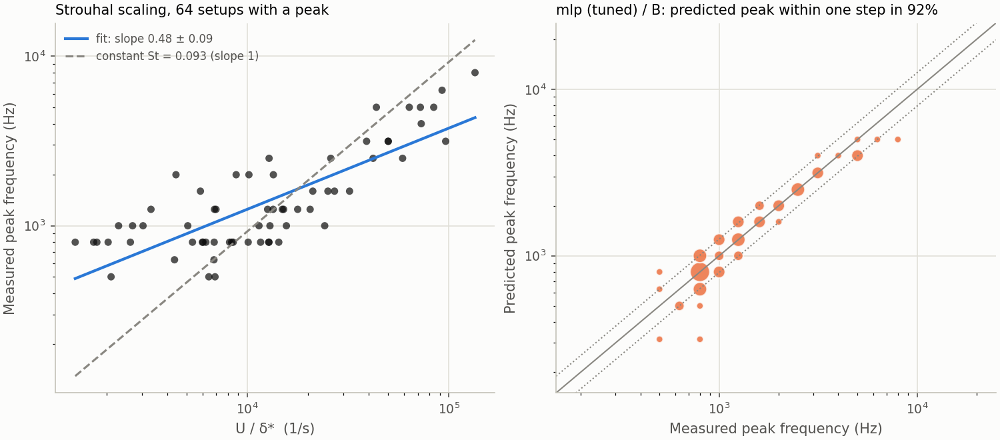
         on log axes with fitted and slope-1 lines. Right, tuned-MLP predicted
         peak frequency against measured peak frequency.

   Left: measured peak frequency against U / δ*, with the fitted line (solid)
   and a constant-Strouhal line of slope 1 (dashed). Right: tuned-MLP
   predicted against measured peak frequency; marker area counts setups and
   dotted lines are ± one 1/3-octave step.

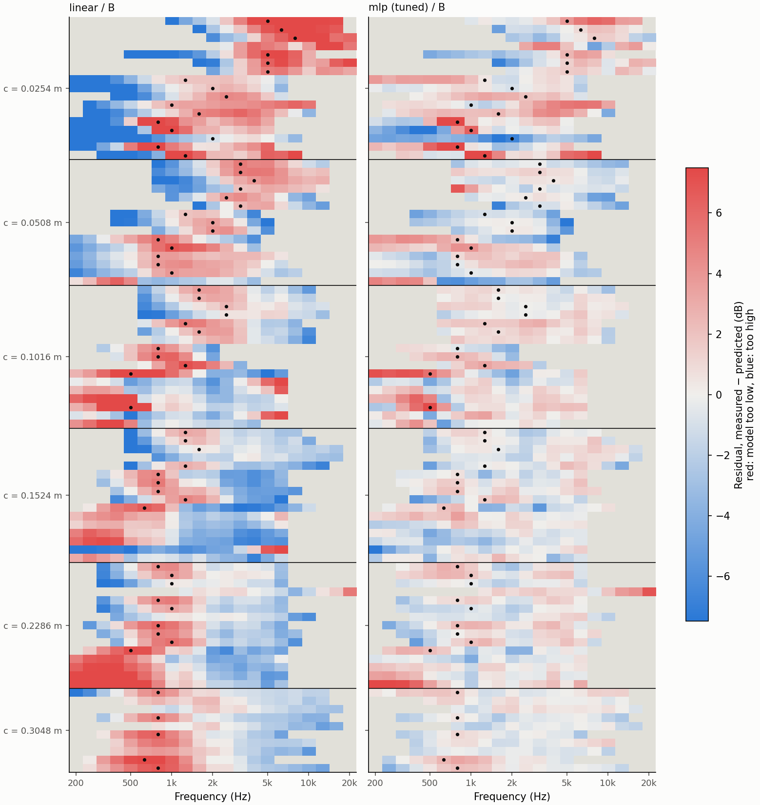
         frequency (columns) for linear and tuned MLP, with measured peaks
         marked by dots.

   Out-of-fold residual (measured − predicted) for every cross-validation
   setup (rows, grouped by chord) and frequency (columns), for linear and the
   tuned MLP, feature set B. Grey: frequency not measured; dots: measured
   peaks.

.. csv-table:: Median share of each setup's squared error within its peak window (peak ± one 1/3-octave step), with the share of frequencies in that window
   :file: generated/peak_error_share_B.csv
   :header-rows: 1

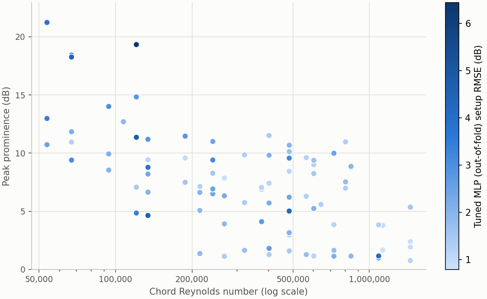
         cross-validation setups, coloured by the tuned MLP's setup RMSE.

   Peak prominence against chord Reynolds number (log axis) for the 90
   cross-validation setups, coloured by the tuned MLP's out-of-fold setup
   RMSE.

Runtime, memory and FLOPs
-------------------------

Each model was trained on all 1,276 cross-validation rows; fit and predict
were each repeated 5 times. FLOP counts are estimates from formulas
(``functions.profiling``).

.. csv-table:: Profile of one fit on all cross-validation rows for linear (sets A, B), the final MLP and the runner-up MLP (set B)
   :file: generated/profile_summary.csv
   :header-rows: 1

.. csv-table:: Cost ratios between the final MLP and linear, and between the final and runner-up MLPs
   :file: generated/profile_comparison.csv
   :header-rows: 1

.. csv-table:: Machine, library versions and thread settings used for the timings
   :file: generated/profile_machine.csv
   :header-rows: 1

Shift tests
-----------

Every setup with one chord (or one velocity) was held out in turn; the final
MLP (random seeds 0, 1, 2) and linear were trained on the remaining
cross-validation setups.

.. csv-table:: Shift tests: RMSE on the held-out chord or velocity (MLP mean ± SD over 3 seeds), with each model's nested-CV RMSE
   :file: generated/shift_tests.csv
   :header-rows: 1

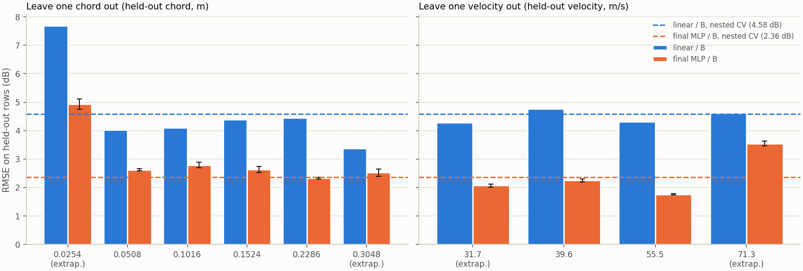
         final MLP, with dashed lines at each model's nested-CV RMSE.

   RMSE on the held-out chord (left) or velocity (right) for linear and the
   final MLP; error bars are the SD over the MLP's 3 seeds, dashed lines the
   nested-CV RMSE, and "extrap." marks values outside the training range.

Physics check: speed order
--------------------------

Setups were grouped by chord and angle (groups with 2 or more speeds); each
setup's SPL was averaged over the bands measured at every speed in its
group, using out-of-fold predictions.

.. csv-table:: Speed-order check: groups and speed pairs whose predicted level rises with velocity
   :file: generated/physics_speed_order.csv
   :header-rows: 1

.. csv-table:: Groups excluded because the measured level does not rise at every higher speed
   :file: generated/physics_speed_order_excluded.csv
   :header-rows: 1

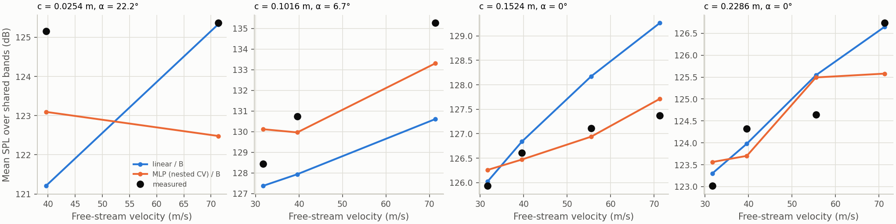
         points, MLP and linear lines.

   Mean SPL over the shared bands against velocity for four chord-angle
   groups: measured (points), nested-CV MLP and linear (lines).

Acceptance criteria
-------------------

The criteria were committed in ``src/functions/acceptance.py`` (commit
``82c1b0d``) before the hold-out evaluation and before the physics check was
written.

**A criterion was removed (HARKing).** The original file also had a criterion
"C1a: the MLP beats linear in at least 13 of the 15 nested-CV folds". C1a was
not written blind: the nested-CV results (MLP better in 15 of 15 folds) were
already known when its threshold was set, so it was HARKing (hypothesising
after the results are known). It was therefore removed post-hoc, as it was not
an honest test, and it was removed rather than counted towards validating the
model. Removing it only takes away a criterion the model passed, so it does
not flatter the verdict. The fold-by-fold comparison is still shown as
supporting evidence (`Accuracy and comparison with linear`_), and the original
file remains in the git history.

.. csv-table:: Acceptance criteria for the final MLP, with thresholds, values and results
   :file: generated/acceptance.csv
   :header-rows: 1

Final hold-out evaluation
-------------------------

Each model was trained once on all 1,276 cross-validation rows (90 setups)
and predicted the 227 hold-out rows (16 setups) once. Run details are in
``results/holdout_run_info.txt``.

.. csv-table:: The hold-out setups
   :file: generated/holdout_setups.csv
   :header-rows: 1

.. csv-table:: Hold-out metrics for linear, the runner-up MLP and the final MLP (bias = mean of measured − predicted)
   :file: generated/holdout_metrics.csv
   :header-rows: 1

.. csv-table:: Cross-validation estimate and hold-out RMSE for each model
   :file: generated/holdout_vs_cv.csv
   :header-rows: 1

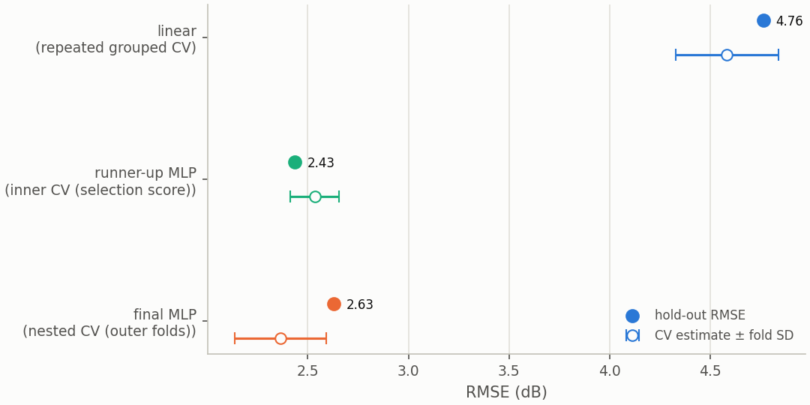
         its hold-out RMSE as a point.

   Cross-validation RMSE ± fold SD (hollow markers with bars) and hold-out
   RMSE (filled markers) for each model.

.. csv-table:: Paired per-setup RMSE differences on the hold-out (final MLP − other model)
   :file: generated/holdout_paired.csv
   :header-rows: 1

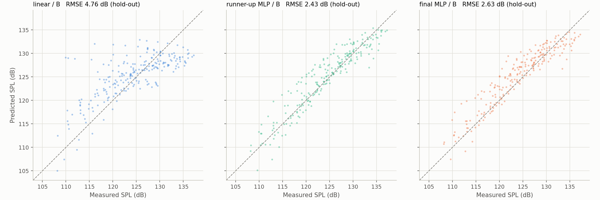
         hold-out: linear, runner-up MLP and final MLP.

   Predicted against measured SPL on the hold-out for linear, the runner-up
   MLP and the final MLP.

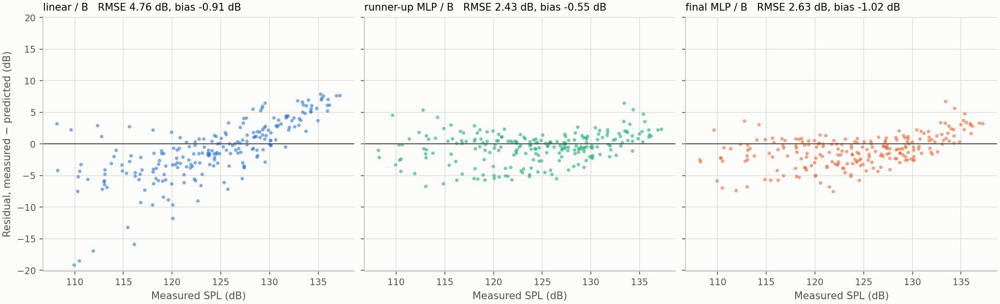
         SPL on the hold-out, for linear, the runner-up MLP and the final MLP.

   Residual (measured − predicted) against measured SPL on the hold-out for
   linear, the runner-up MLP and the final MLP.

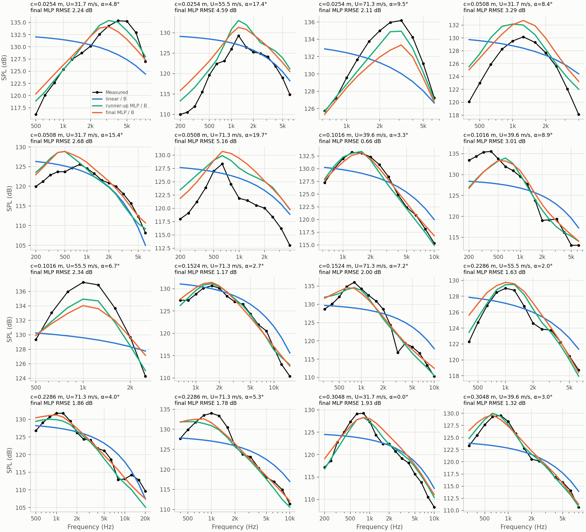
         with measured points and lines for the three models.

   Measured spectrum (black) and predictions of linear (blue), the runner-up
   MLP (green) and the final MLP (orange) for every hold-out setup.

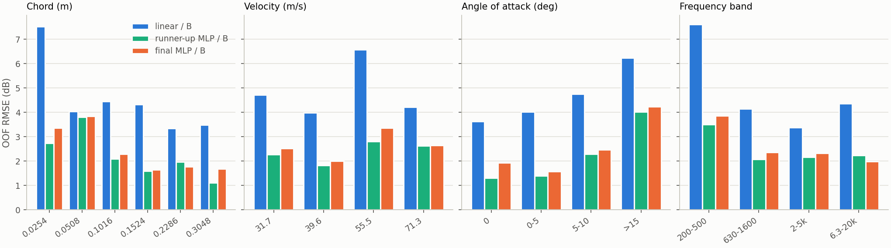
         frequency band for the three models.

   Hold-out RMSE by chord, velocity, angle band and frequency band for the
   three models.

.. csv-table:: Hold-out RMSE by chord, velocity, angle band and frequency band (setups and rows per group)
   :file: generated/holdout_breakdown.csv
   :header-rows: 1
